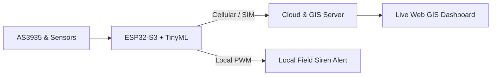

# ⚡ IoT Rural Lightning Early Warning System
> **An AI-powered edge-computing & GIS surveillance system for real-time lightning prediction in rural areas.**

<!-- আপনার 3D পোস্টারটি প্রধান ব্যানার হিসেবে প্রদর্শন -->
[./Project1_ESP32S3_SIM_Cloud_Siren_3D_Poster.jpg]

---

### 🌐 System Architecture & Pipeline
<!-- আপনার পাইপলাইন ইমেজটি যুক্ত করা -->
[./3Stream_TinyML_SIM_Siren_Pipeline.png]

---

### 🔄 Data & Signal Flow (Live Diagram)

---

### 🗂️ Project Modules
| মডিউল | বিবরণ | প্রযুক্তি |
| :--- | :--- | :--- |
| **Firmware** | সেন্সর ডেটা রিডিং, ফলস পজিটিভ ফিল্টারিং ও সাইরেন কন্ট্রোল | C++, PlatformIO, ESP32 |
| **Web GIS** | রিয়েল-টাইম ক্লাউড মনিটরিং ও জিওগ্রাফিক ড্যাশবোর্ড | Leaflet.js, HTML5, CSS3 |
| **Simulation** | TinyML এজ ইনফারেন্স ও অ্যালার্ম পাইপলাইন | Arduino IDE (.ino) |
